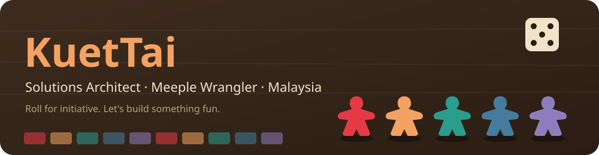
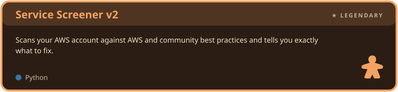
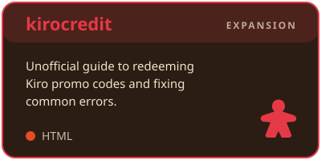
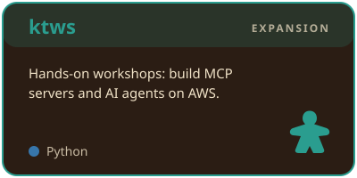

  

  

  
  
  

---

## 🎴 Player Card

| Player | KuetTai |
|---|---|
| 🧙 **Class** | Solutions Architect |
| 🏰 **Guild** | Amazon Web Services |
| 🗺️ **Home board** | Malaysia 🇲🇾 |
| 🎯 **Current quest** | Teaching MCP servers and AI agents on AWS |
| 🎲 **Off-duty** | Building tools for game night |

## 🧰 Inventory

**🪵 Core resources**

**✨ Special abilities**

**🤖 AI companions**

---

## 🏆 Legendary Card

## 🧩 Expansion Packs

  
  

💳 [kirocredit live site](https://kuettai.github.io/kirocredit/) · 🧪 [ktws workshops](https://github.com/kuettai/ktws)

## 🎉 Party Games

| Project | What it is |
|---|---|
| 🔐 **[unlock-cloud](https://github.com/kuettai/unlock-cloud)** | *re:Solve*, a mobile-first escape room card game that teaches through storytelling |
| ☕ **[rlc-cafe-pos](https://github.com/kuettai/rlc-cafe-pos)** | Sunday café POS for my church (Oasis of Care, PJ). Offline-ready PWA on AWS Lambda, DynamoDB and CDK |
| 📖 **[biblestory](https://github.com/kuettai/biblestory)** · [live](https://kuettai.github.io/biblestory/) | Bible stories retold for study, with timelines, offline maps and quizzes |
| 🎲 **Board game toolkit** | Tools for game night: |
| &nbsp;&nbsp;↳ **[bgrules](https://github.com/kuettai/bgrules)** · [live](https://kuettai.github.io/bgrules/) | Board game rules for quick lookup at the table, or a refresher before game night |
| &nbsp;&nbsp;↳ **[boardgame-timer](https://github.com/kuettai/boardgame-timer)** · [live](https://kuettai.github.io/boardgame-timer/) | Installable, offline turn timer: per-player total time or turn + round countdowns |

---

## 📊 Scoreboard

  

## 🐍 Turn Tracker

<picture>
  <source media="(prefers-color-scheme: dark)" srcset="https://raw.githubusercontent.com/kuettai/kuettai/output/snake-dark.svg" />
  
</picture>

## 🃏 Draw a Card

<b>Flip it over</b>

 

- 🎲 Can't find the rulebook mid-game? I built [bgrules](https://kuettai.github.io/bgrules/) for that.
- ⏳ Someone taking forever on their turn? That's what [boardgame-timer](https://kuettai.github.io/boardgame-timer/) is for.
- ☕ My café POS only goes live on Sundays.
- 🔐 I turned cloud lessons into an escape room card game.

---

  <b>🤝 Pull up a chair.</b> Got a project, a workshop idea or a game recommendation? <a href="https://www.linkedin.com/in/kuettai/">Find me on LinkedIn</a>.
    
  <i>Thanks for stopping by. Pass the first-player token on your way out. 🎲</i>

