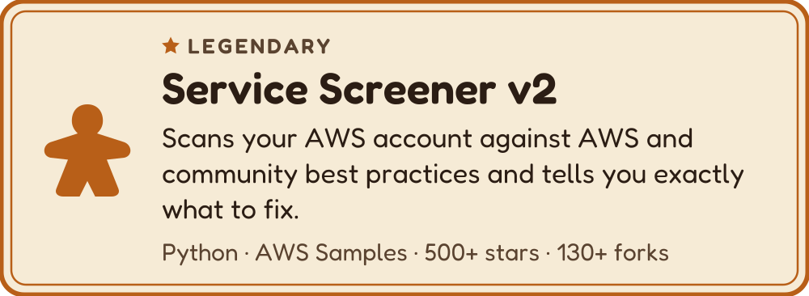
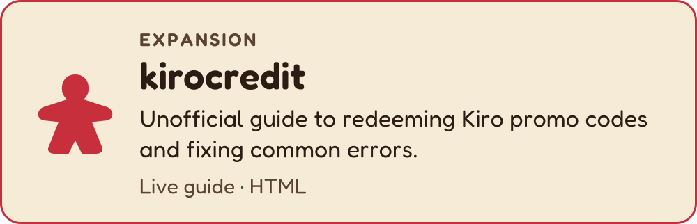
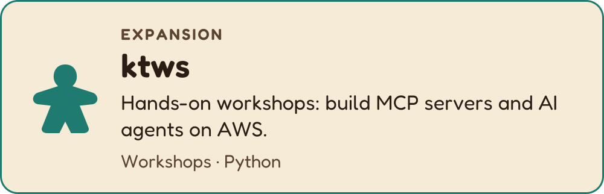
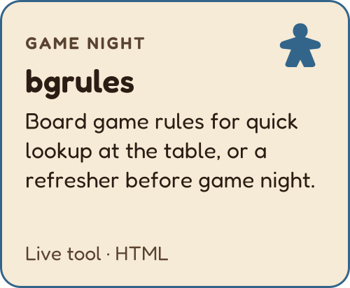
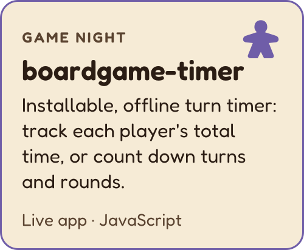
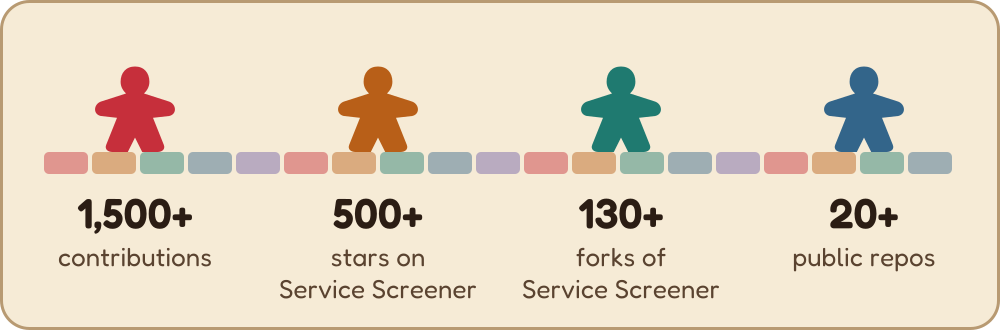

<picture>
  <source media="(prefers-color-scheme: dark)" srcset="assets/banner-dark.svg" />
  
</picture>

  <a href="https://www.linkedin.com/in/kuettai/"><b>LinkedIn</b></a> ·
  <a href="mailto:kt.xtrik@gmail.com"><b>Email</b></a> ·
  

## Player board

**Current quest:** teaching people to build MCP servers and AI agents on AWS. 
**Resources:** AWS · Python · PHP · Linux · RDBMS 
**Specialties:** scalable enterprise database design · business process automation 
**Companions:** Kiro · Claude

## Legendary card

<a href="https://github.com/aws-samples/service-screener-v2">
  <picture>
    <source media="(prefers-color-scheme: dark)" srcset="assets/cards/service-screener-v2-dark.svg" />
    
  </picture>
</a>

## Expansions

<a href="https://kuettai.github.io/kirocredit/">
  <picture>
    <source media="(prefers-color-scheme: dark)" srcset="assets/cards/kirocredit-dark.svg" />
    
  </picture>
</a>
<a href="https://github.com/kuettai/ktws">
  <picture>
    <source media="(prefers-color-scheme: dark)" srcset="assets/cards/ktws-dark.svg" />
    
  </picture>
</a>

## Game night

<a href="https://kuettai.github.io/bgrules/">
  <picture>
    <source media="(prefers-color-scheme: dark)" srcset="assets/cards/bgrules-dark.svg" />
    
  </picture>
</a>
<a href="https://kuettai.github.io/boardgame-timer/">
  <picture>
    <source media="(prefers-color-scheme: dark)" srcset="assets/cards/boardgame-timer-dark.svg" />
    
  </picture>
</a>

## Side quests

- **[unlock-cloud](https://github.com/kuettai/unlock-cloud)**: *re:Solve*, a mobile-first escape room card game that teaches through storytelling.
- **[rlc-cafe-pos](https://github.com/kuettai/rlc-cafe-pos)**: the POS for my church's Sunday café (Oasis of Care, PJ). An offline-ready PWA on AWS Lambda, DynamoDB and CDK.
- **[biblestory](https://kuettai.github.io/biblestory/)**: Bible stories retold for study, with timelines, offline maps and quizzes.

## Score track

<picture>
  <source media="(prefers-color-scheme: dark)" srcset="assets/score-dark.svg" />
  
</picture>

## Table talk

Pull up a chair. Got a project, a workshop idea or a game recommendation? Find me on [LinkedIn](https://www.linkedin.com/in/kuettai/) or send an [email](mailto:kt.xtrik@gmail.com).

*Thanks for stopping by. Pass the first-player token on your way out.*
